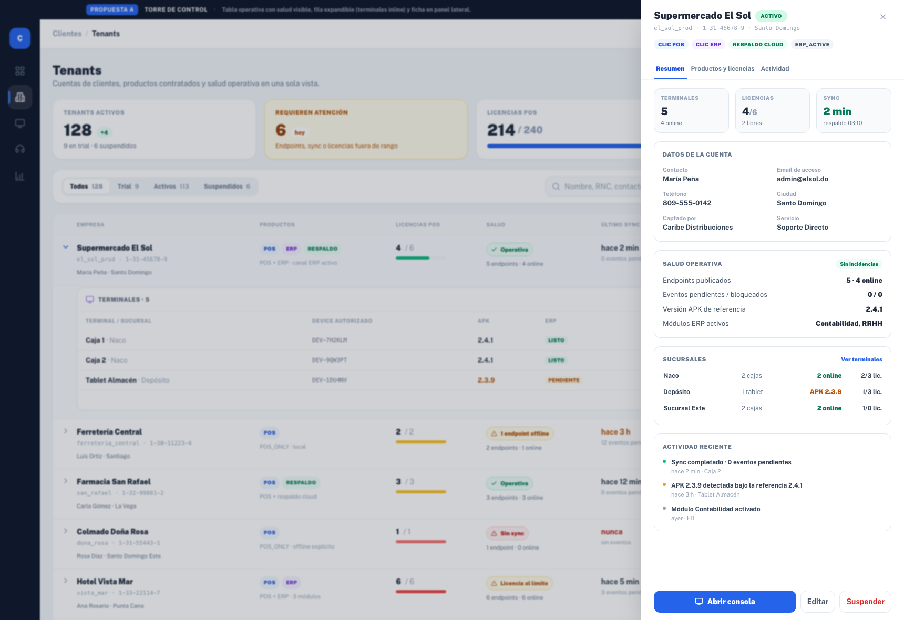
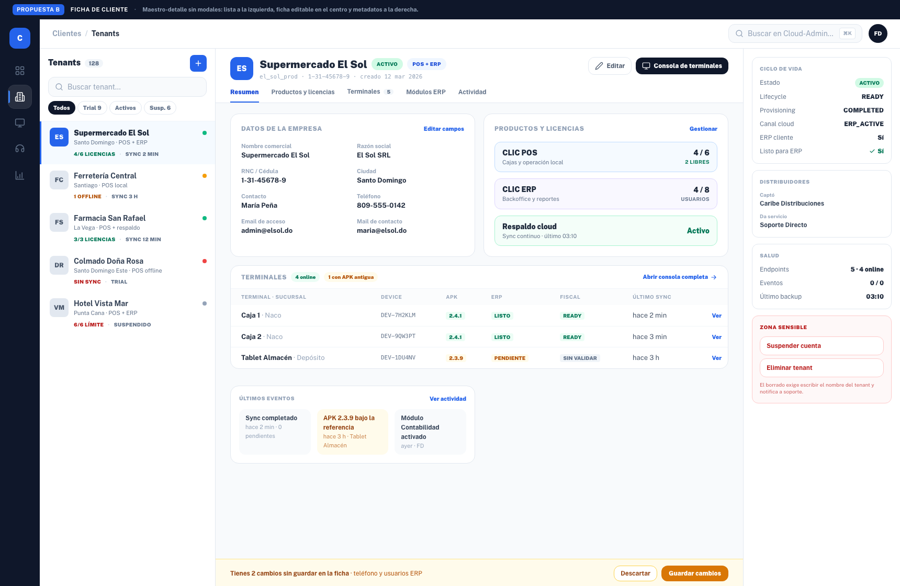
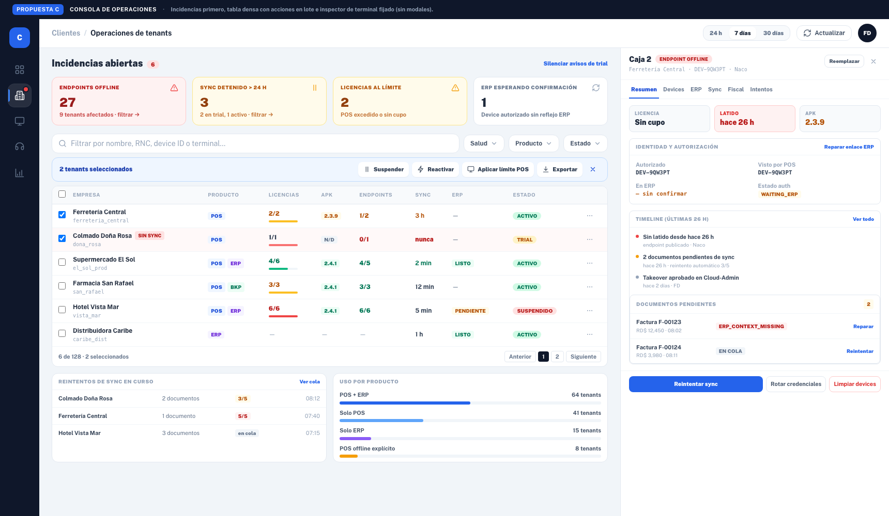

# Módulo Tenants — tres propuestas de rediseño

**Sin cambios de código.** Este documento y los mockups viven en `mockups/tenants/`; `src/` no se tocó.

Cada propuesta es un HTML estático autocontenido (Tailwind compilado en `mockup.css`) con su PNG listo para revisar:

| # | Propuesta | Archivo |
| --- | --- | --- |
| A | Torre de control | `propuesta-a-torre-de-control.html` · `.png` |
| B | Ficha de cliente | `propuesta-b-ficha-cliente.html` · `.png` |
| C | Consola de operaciones | `propuesta-c-consola-operaciones.html` · `.png` |

---

## Qué hay hoy (punto de partida)

- La pantalla es **una tabla + 7 modales apilados**: alta, edición, productos (x2), módulos ERP, consola de terminales, takeover y rebuild.
- La tabla muestra estado (`ACTIVE`/`TRIAL`/`SUSPENDED`) pero **no salud**: licencias usadas, endpoints online, último sync, versión APK.
- La consola de terminales (~1.400 líneas de UI en un modal `max-w-6xl` con scroll interno) concentra 6 pestañas por terminal.
- Sin filtros por producto/salud, sin acciones masivas y sin señal de incidencias: para saber "qué está roto hoy" hay que abrir tenant por tenant.

Las tres propuestas atacan ese mismo problema con filosofías distintas.

---

## Propuesta A — Torre de control



**Idea:** la lista deja de ser un directorio y pasa a ser un tablero operativo: KPIs arriba, salud en cada fila y detalle sin perder el contexto.

**Estructura**
1. **Franja de KPIs**: tenants activos, requieren atención, licencias POS usadas/total, endpoints online.
2. **Filtros segmentados** (Todos / Trial / Activos / Suspendidos) + búsqueda + filtros por producto y salud.
3. **Tabla operativa** con columnas nuevas: `Licencias POS` (usadas/total con barra), `Salud` (semáforo + endpoints), `Último sync`.
4. **Fila expandible** que muestra las terminales del tenant *inline* (device, APK, ERP, fiscal) → el caso "quiero ver las cajas" deja de exigir un modal.
5. **Ficha en panel lateral (drawer 500 px)**: resumen, datos, salud, sucursales, actividad y acciones. La consola completa queda a un clic.

**A favor**
- Cambio de menor riesgo: conserva la tabla y la lógica actual; casi todo es composición.
- Resuelve los dos problemas más caros (salud invisible y modal para todo) sin reescribir la consola.
- Convive con los modales de alta/edición tal como están hoy.

**En contra**
- El drawer es otro patrón de "capa flotante"; si luego se quiere deep-linking conviene pasarlo a ruta.
- Los KPIs requieren agregación (hoy `getTenants` no trae endpoints ni licencias agregadas): hace falta un endpoint de resumen o calcularlo en cliente con límite de tenants.

**Esfuerzo:** medio (1–2 semanas de UI + endpoint de métricas).

---

## Propuesta B — Ficha de cliente



**Idea:** el tenant es un **registro**, no una fila. Maestro-detalle tipo CRM: lista a la izquierda, ficha editable en el centro, metadatos y zonas sensibles a la derecha.

**Estructura**
1. **Rail maestro (336 px)**: buscador, chips de estado y tarjetas de tenant con salud resumida (licencias, sync) y semáforo.
2. **Ficha central** con pestañas: `Resumen`, `Productos y licencias`, `Terminales`, `Módulos ERP`, `Actividad`.
3. **Edición en sitio**: los campos se editan en la propia ficha con una **barra de cambios pendientes** (Descartar / Guardar) — se eliminan los modales de alta y edición.
4. **Rail derecho**: ciclo de vida (lifecycle, provisioning, canal cloud), distribuidores, salud y **zona sensible** (suspender, eliminar con confirmación por nombre).
5. Alta de tenant como flujo aparte de 2 pasos (datos → productos → credenciales).

**A favor**
- Es la propuesta que **más modales elimina**: el trabajo diario pasa a ser leer y editar un registro.
- Escala bien cuando el tenant tiene muchos productos, módulos ERP y actividad.
- Deep-linking natural (`/tenants/:id`) y mejor accesibilidad (nada tapado por capas).

**En contra**
- Reescritura de información, no solo de estilo: hay que introducir ruta de detalle y reescribir la edición como formulario en sitio.
- Comparar tenants entre sí se vuelve peor: el maestro es una lista compacta, no una tabla comparable.
- El rail derecho añade densidad; en 1280 px obliga a colapsar columnas.

**Esfuerzo:** alto (3–4 semanas: ruta nueva, formularios en sitio, permisos por acción).

---

## Propuesta C — Consola de operaciones



**Idea:** pensada para quien da soporte todo el día: **incidencias primero**, tabla densa con acciones en lote e inspector de terminal fijado (sin modales).

**Estructura**
1. **Bandeja de incidencias** clickable: endpoints offline, sync detenido > 24 h, licencias al límite, ERP esperando confirmación → cada tarjeta filtra la tabla.
2. **Tabla densa** con selección múltiple y **barra de acciones en lote**: suspender, reactivar, aplicar límite POS, exportar.
3. **Columnas de operación**: licencias, APK vs referencia, endpoints, sync, estado ERP — con semáforo por celda.
4. **Inspector fijado (520 px)** con las pestañas actuales de la consola (Resumen, Devices, ERP, Sync, Fiscal, Intentos), timeline de las últimas 24 h y documentos pendientes con acción de reparación.
5. **Cola de trabajo** debajo: reintentos de sync en curso y distribución por producto.

**A favor**
- Es la única que responde "¿qué está roto ahora?" en la primera pantalla, sin abrir nada.
- Las acciones en lote son el mayor ahorro de tiempo real en soporte.
- El inspector fijado conserva la consola actual y elimina el modal gigante.

**En contra**
- Requiere soporte de backend para métricas de incidencia y para acciones en lote (hoy todo es por tenant/terminal).
- Densidad alta: menos adecuada para el equipo comercial que para soporte.
- Si no se cuida, se convierte en un panel de alertas ruidoso.

**Esfuerzo:** alto (3–4 semanas: consultas de incidencia, endpoints en lote, auditoría de acciones masivas).

---

## Comparativa

| Criterio | A · Torre de control | B · Ficha de cliente | C · Consola de operaciones |
| --- | --- | --- | --- |
| Pregunta que responde | "¿Cómo está mi cartera?" | "¿Qué es este cliente?" | "¿Qué está roto ahora?" |
| Modales que elimina | 1 (consola) | 4 (alta, edición, productos, consola) | 2 (consola, takeover) |
| Comparar tenants | Excelente (tabla) | Débil (lista) | Excelente (tabla densa) |
| Editar tenant | Modal actual | En sitio (mejor) | Modal actual |
| Acciones masivas | No | No | Sí |
| Riesgo de implementación | Bajo | Alto | Alto |
| Esfuerzo estimado | 1–2 sem | 3–4 sem | 3–4 sem |
| Reutiliza la consola actual | Sí, tal cual | Sí, como pestaña | Sí, como inspector |

## Recomendación

**A como base, con dos injertos de C**: la bandeja de incidencias como cabecera de la lista y la selección múltiple con acciones en lote cuando el backend lo permita. A es la que más valor entrega por unidad de riesgo: ataca salud invisible y el "todo en modales" sin reescribir la información del módulo, y deja B disponible como evolución si el uso se vuelve más de ficha que de cartera.

Las tres propuestas se apoyan en el refactor ya mergeado (PR #378): `TenantListPanel`, `TenantCreateModal`, `TenantEditModal`, `TenantTerminalConsole` y `useTenantTerminalConsole` son precisamente las piezas que se reemplazarían o reutilizarían en cada escenario.

## Cómo revisar los mockups

Abre cualquiera de los `.html` en el navegador (usan `mockup.css`, generado con la config de Tailwind de la app, y la fuente Public Sans). Si editas el HTML, recompila el CSS con:

```bash
npx tailwindcss -c mockups/tenants/tailwind.mockup.config.js \
  -i mockups/tenants/mockup.input.css -o mockups/tenants/mockup.css --minify
```

Datos, nombres y cifras son ficticios y solo ilustran densidad y jerarquía.
