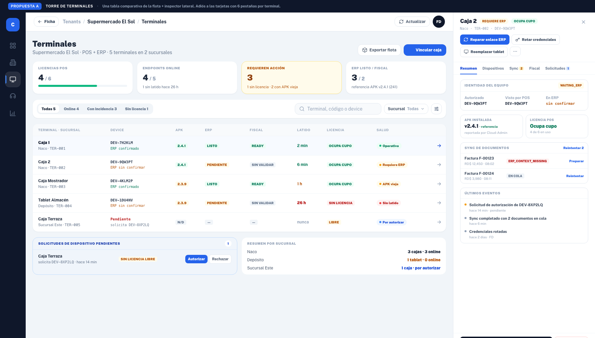
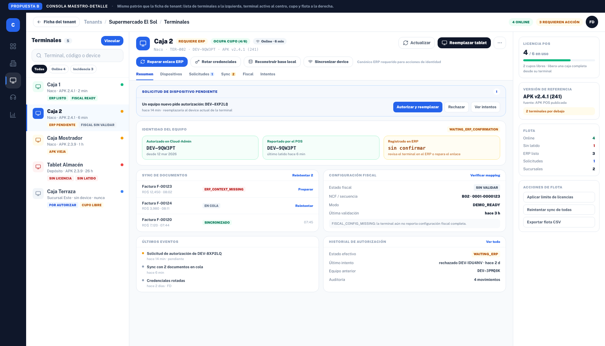
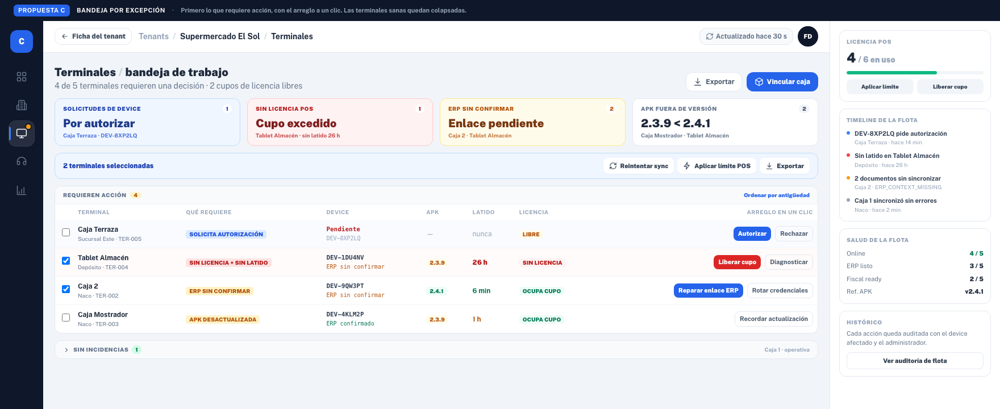

# Módulo de terminales — tres propuestas de rediseño

**Sin cambios de código.** Todo vive en `mockups/terminales/`; `src/` no se tocó.

| # | Propuesta | Archivo |
| --- | --- | --- |
| A | Torre de terminales | `propuesta-a-torre-de-terminales.html` · `.png` |
| B | Consola maestro-detalle | `propuesta-b-consola-maestro-detalle.html` · `.png` |
| C | Bandeja por excepción | `propuesta-c-bandeja-por-excepcion.html` · `.png` |

---

## Punto de partida (lo que hay hoy)

El módulo "Terminales Activas del Tenant" vive en `TenantTerminalConsole.tsx` (1.624 líneas) y se abre a pantalla completa en `/tenants/:tenantId/terminales`.

- **Una tarjeta por terminal**, y dentro de cada tarjeta **6 pestañas**: Resumen, Dispositivos, Solicitudes, Preparación ERP, Sync, Fiscal (más Intentos cuando aplica). Con 5 terminales hay que recorrer ~30 pestañas para comparar la flota.
- Los KPIs están arriba (licencia POS, endpoints online, fuera de versión, clientes/cajas, ERP listo, server master, endpoint cloud, revocadas/offline), pero **nada dice qué terminal requiere una decisión ahora**.
- Hay **14 acciones** repartidas entre pestañas: reemplazar tablet, reconstruir base local, rotar credenciales, revocar equipo, limpiar devices, liberar cupo, reparar enlace ERP, sincronizar device, reintentar readiness/perfil, reintentar documentos, reconciliar identidad, autorizar/rechazar solicitudes, aplicar límite de licencias.
- La **identidad del equipo** —autorizado en Cloud-Admin / reportado por el POS / registrado en el ERP— es el dato más crítico para soporte y está enterrada en el resumen de cada tarjeta, con reglas de disponibilidad (canónico ERP, offline explícito) que el usuario no puede anticipar.

Las tres propuestas resuelven el mismo problema con jerarquías distintas.

---

## Propuesta A — Torre de terminales



**Idea:** la flota se compara en **una tabla**, y el detalle del equipo seleccionado se abre en un **inspector fijado** a la derecha (no modal, no tarjetas apiladas).

**Estructura**
1. **KPIs de flota**: licencias POS usadas/total, endpoints online, requiere acción, ERP listo / fiscal.
2. **Filtros** por estado (todas / online / con incidencia / sin licencia), búsqueda y filtro por sucursal.
3. **Tabla de flota** con columnas: terminal y sucursal, device (con si está confirmado en ERP), APK, ERP, fiscal, latido, licencia y **semáforo de salud**.
4. **Solicitudes de dispositivo pendientes** como bloque propio con acciones directas (autorizar / rechazar).
5. **Inspector** con las tres identidades del equipo, versión y licencia, sync de documentos, timeline y acciones principales.
6. Resumen por sucursal (cajas por tienda y estado agregado).

**A favor**
- Es la vista que responde "¿cómo está la flota?" de un vistazo; ideal para comparar APK, latidos y licencias.
- Mantiene la consola actual como base: casi todo es recomposición de datos ya cargados.
- Escala bien con muchas terminales (10-50 cajas por tenant).

**En contra**
- Sigue habiendo dos superficies (tabla + inspector) con bastante densidad.
- Las acciones profundas (reconciliación, fiscal) necesitan sitio: el inspector acaba teniendo pestañas otra vez.

**Esfuerzo:** medio (1–2 semanas).

---

## Propuesta B — Consola maestro-detalle



**Idea:** el mismo patrón que la ficha de tenant recién implementada (PR #380): **lista de terminales a la izquierda, terminal activo al centro, cupo y flota a la derecha**. La consola deja de ser una pila de tarjetas y pasa a ser un registro por terminal.

**Estructura**
1. **Lista de terminales (300 px)** con semáforo, sucursal, APK, latido y chips de incidencia.
2. **Cabecera del terminal** con badges (requiere ERP, ocupa cupo, online) y las acciones primarias en una barra: reparar enlace ERP, rotar credenciales, reconstruir base, sincronizar device.
3. **Identidad en tres columnas** —autorizado / reportado por POS / registrado en ERP— con el aviso `WAITING_ERP_CONFIRMATION` y la acción de reparación al lado.
4. **Aviso de solicitud pendiente** con "Autorizar y reemplazar / Rechazar / Ver intentos".
5. **Pestañas del terminal**: Resumen, Dispositivos, Solicitudes, Sync, Fiscal, Intentos (se conserva el contenido actual).
6. **Rail derecho**: licencia POS con cupos libres, versión de referencia de la APK, salud de la flota y acciones de flota.

**A favor**
- Coherencia total con la ficha de tenant: el usuario aprende un patrón y lo reutiliza.
- La identidad del equipo deja de estar escondida: es lo primero del terminal.
- Mucho menos scroll y cero tarjetas anidadas; el estado de cada terminal es visible desde la lista.

**En contra**
- Comparar la flota completa cuesta más que en una tabla (hay que recorrer la lista).
- Exige reorganizar el componente actual en piezas nuevas (es el cambio más profundo de los tres).

**Esfuerzo:** alto (3 semanas), pero reutiliza la lógica del hook existente.

---

## Propuesta C — Bandeja por excepción



**Idea:** ordenar el módulo por **trabajo pendiente**, no por inventario. Arriba las excepciones, con el arreglo a un clic; las terminales sanas quedan colapsadas.

**Estructura**
1. **Bandeja de excepciones** en cuatro tarjetas clicables: solicitudes de device, sin licencia POS, ERP sin confirmar, APK fuera de versión.
2. **Barra de lote**: reintentar sync, aplicar límite POS, exportar sobre la selección.
3. **"Requieren acción"**: tabla priorizada donde cada fila dice *qué* necesita y ofrece **el arreglo en un clic** (autorizar, liberar cupo, reparar enlace, recordar actualización).
4. **"Sin incidencias"** colapsada (una fila por terminal sana).
5. **Rail derecho** con cupo, timeline de la flota, salud agregada e histórico/auditoría.

**A favor**
- Es la vista más rápida para soporte: se ve qué hacer y se hace sin navegar.
- Reduce el tiempo por caso y hace evidente el cupo excedido y las autorizaciones pendientes.

**En contra**
- No sirve para inspeccionar una terminal concreta: sigue necesitando una vista de detalle al hacer clic.
- Requiere acciones en lote y un modelo de "excepciones" que hoy se deriva en cliente.
- Riesgo de convertirse en un panel de alertas ruidoso si no se puede silenciar.

**Esfuerzo:** alto (3 semanas; el lote y la auditoría piden backend).

---

## Comparativa

| Criterio | A · Torre de terminales | B · Maestro-detalle | C · Bandeja por excepción |
| --- | --- | --- | --- |
| Pregunta que responde | "¿Cómo está la flota?" | "¿Qué pasa con esta terminal?" | "¿Qué tengo que arreglar ahora?" |
| Comparar terminales | Excelente | Media | Media |
| Identidad del device | Visible en tabla + inspector | Protagonista | Resumida por fila |
| Acciones profundas | Inspector con pestañas | Pestañas del terminal | Enlaces al detalle |
| Acciones en lote | No | En el rail derecho | Sí, con selección |
| Coherencia con la ficha de tenant | Media | **Alta** | Baja |
| Riesgo de implementación | Bajo | Medio | Alto |
| Esfuerzo | 1–2 sem | ~3 sem | ~3 sem |

## Recomendación

**B como estructura principal**, con dos injertos: el **aviso de solicitud pendiente** y la **bandeja de excepciones de C** como cabecera de la lista, y la **tabla de flota de A** como vista alternativa (toggle "lista / tabla") para tenants con muchas cajas.

B es la evolución natural: el usuario acaba de aprender el patrón maestro-detalle en Tenants, la identidad del equipo pasa a primer plano (que es el problema real de soporte) y el cambio se apoya en el hook `useTenantTerminalConsole` que ya concentra toda la lógica.

## Qué se reutiliza del código actual

| Pieza | Uso en la propuesta B |
| --- | --- |
| `useTenantTerminalConsole` (1.500 líneas) | Se mantiene: estado, carga, acciones y valores derivados |
| `TenantDetailTerminals` (tabla compacta en la ficha) | Base de la lista y del bloque de identidad |
| `lib/tenantTerminalFormatting` / `terminalIdentity` | Sin cambios: etiquetas, APK de referencia, estados |
| `TerminalTakeoverModal` / `TerminalRebuildModal` | Se mantienen (acciones puntuales) o pasan a panel lateral |
| `TenantTerminalConsole` | Se reemplaza por las piezas nuevas (lista, detalle, rail) |

## Cómo revisar los mockups

Abre cualquiera de los `.html` en el navegador (usan `mockup.css`, generado con la config de Tailwind de la app, y la fuente Public Sans). Si editas el HTML, recompila con:

```bash
npx tailwindcss -c mockups/terminales/tailwind.mockup.config.js \
  -i mockups/terminales/mockup.input.css -o mockups/terminales/mockup.css --minify
```

Datos, terminales y cifras son ficticios y solo ilustran densidad y jerarquía.
